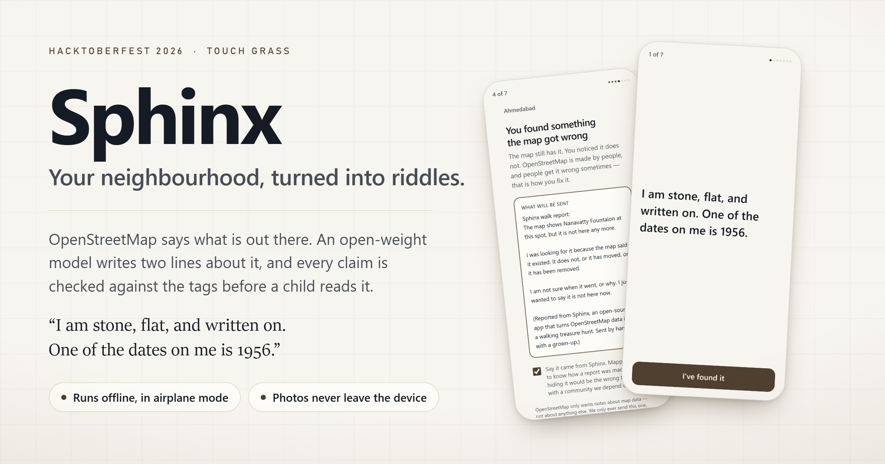

# Sphinx

<div align="center">



**Your neighbourhood, turned into riddles.**

[](https://0dvsh0.github.io/sphinx/)
[](https://dev.to/challenges/hacktoberfest-week1-2026-10-05)
[](https://tinker.thinkingmachines.ai)
[](https://nextjs.org/)
[-orange?style=flat-square)](https://huggingface.co/apple/MobileCLIP-S0)
[](#how-it-plays-offline)
[](#privacy--zero-network-architecture)
[](#automated-verification-suites)
[](#licence--attribution)

<br />

*An open-weight model reads OpenStreetMap data around you and turns real places into riddles.*  
*You walk to find each one. An on-device vision model checks your photo without uploading a byte.*  
*When something is missing from the map, the player's report goes back to OpenStreetMap.*

**[🌐 Play Live Demo](https://0dvsh0.github.io/sphinx/)** • [Watch Video Walkthrough (YouTube)](https://youtu.be/5VDXL1FvSP8) • [The Twist: "It's Gone"](#its-gone--the-map-gets-fixed) • [Safety Charter](#critical-safety-for-children) • [Tinker Fine-Tune](#fine-tuning-a-riddle-writer-with-tinker) • [Verification Suites](#automated-verification-suites)

</div>

---

## Table of Contents

- [Why Sphinx Exists](#why-sphinx-exists)
- [How It Works (The Walk Loop)](#how-it-works-the-walk-loop)
- ["It's Gone" — Fixing the Map](#its-gone--the-map-gets-fixed)
- [On-Device Photo Check (Zero Network)](#on-device-photo-check-zero-network)
- [Fine-Tuning a Riddle Writer with Tinker](#fine-tuning-a-riddle-writer-with-tinker)
- [Critical Safety for Children](#critical-safety-for-children)
- [Privacy & Zero-Network Architecture](#privacy--zero-network-architecture)
- [How It Plays Offline](#how-it-plays-offline)
- [Development & Verification](#running-it)
- [Automated Verification Suites](#automated-verification-suites)
- [Architecture & Codebase Tour](#architecture--codebase-tour)
- [Licence & Attribution](#licence--attribution)

---

## Why Sphinx Exists

The world is the content. Every riddle points at a real object that actually exists on Earth: a bronze statue, a Victorian drinking fountain, a historic blue plaque, an ancient boundary stone, or a botanical specimen. You cannot play Sphinx from a couch. And unlike virtually every screen product designed for young people, finishing Sphinx takes you **away** from the screen.

### The Anti-Engagement Philosophy

The theme of Week 1 of the Hacktoberfest AI Challenge is **Touch Grass** — getting people off the glass and into the physical world. Sphinx rejects engagement-maximising dark patterns:

- **No streaks, badges, points, or leaderboards.** A hunt that nags is a hunt that gets deleted.
- **No infinite feeds.** Every walk is finite, bounded, and walkable within daylight.
- **The reveal is the reward.** No confetti or "+50 XP" fireworks. The reward is a factual, historical insight about the physical object you just found.
- **Pocket mode as a core feature.** After 20 seconds of inactivity on a riddle, the screen dims to black. A child walking through a street staring at a glowing screen is not touching grass. **Time-to-pocket** is our primary product metric.

---

## How It Works (The Walk Loop)

```
       [OpenStreetMap Overpass API]
                    │
                    ▼
     [Grounded Riddle Generator / LoRA] ──► [Zero-Movement Safety Linter]
                    │
                    ▼
          [Adult Review & Consent] ────────► [Parent Panel & Stranger Script]
                    │
                    ▼
         [IndexedDB Local Storage] ────────► [Airplane Mode Ready]
                    │
                    ▼
              [Riddle Screen] ─────────────► [Pocket Mode: Screen Dims]
                    │
         ┌──────────┴──────────┐
         ▼                     ▼
 [Camera Photo Check]    ["It's Gone"]
  MobileCLIP-S0 (11MB)    Drafts OSM Note for adult review
         │                     │
         ▼                     ▼
  [Fact Reveal]          [Map of Earth is Fixed]
```

1. **Build a Walk**: Give Sphinx any town or coordinate. Sphinx queries OpenStreetMap (Overpass API) for riddle-worthy candidates (statues, memorials, fountains, plaques), computes a walkable route, and scores candidates for safety and visibility.
2. **Adult Gate & Review**: Before a child sees a single stop, a parent reviews every riddle and educational fact on a dedicated screen.
3. **Airplane Mode**: The walk is saved to local IndexedDB. The app shell is precached by a narrow Service Worker. Signal can be turned completely off.
4. **Walk & Solve**: Read the two-line riddle, slip the phone into a pocket, and look up.
5. **Verify**: When you reach the target, optionally point the camera at it. MobileCLIP-S0 runs completely in the browser on WebAssembly, scoring visual plausibility with zero network latency and zero photo transmission.
6. **Learn**: Unlock a historical fact about the site you are standing in front of.

---

## "It's Gone" — The Map Gets Fixed

Every stop contains a quiet, deliberate option: **"There is nothing here"**.

When a fountain has been removed, a plaque damaged, or an artwork moved, the player taps **"It's gone"**. Sphinx responds:

> **You found something the map got wrong.**  
> *The map still has it. You noticed it does not. OpenStreetMap is made by people, and people get it wrong sometimes — that is how you fix it.*

Sphinx then drafts a polite, structured **OpenStreetMap Note** containing the exact node ID, coordinates, and context, and presents it to the adult to review and send.

| Principle | Why It Matters |
|---|---|
| **Never Auto-Post** | OSM guidelines prohibit automated bots: *"Notes should be human-to-human communication."* A human must explicitly verify and tap submit. |
| **Complete Transparency** | The full draft is shown on screen before submission. Courteous notes get acted upon by local mappers. |
| **Civil & Honest** | Does not speculate why an object vanished. A nine-year-old child surveyed the site, not a professional cartographer. |
| **Sensitive Exclusions** | War memorials cannot be marked "gone" by a child — avoiding noise if a child simply failed to locate it. |
| **Zero Synthetic Testing on Live OSM** | We test note creation against a dedicated local HTTP stub test suite. Real volunteer mapper infrastructure is never spammed. |

---

## On-Device Photo Check (Zero Network)

Each stop carries a **visual signature** derived from the same OpenStreetMap tags as the riddle, ensuring the photo check and riddle never disagree about what the object is.

```
            [Camera Capture (Canvas)]
                        │
                        ▼
           [MobileCLIP-S0 Vision Tower]
              11.3 MB ONNX (WASM)
                        │
                        ▼  512-d Image Vector
              [Cosine Similarity] ◄─── Precomputed Text Embeddings
                        │              (84 KB JSON, 20 Signatures)
         ┌──────────────┼──────────────┐
         ▼              ▼              ▼
     Score ≥ 0.26   Unsure Band    Score < 0.18
        [Match]     ["Can't Tell"]  ["Not It"]
```

### How It Achieves a 13× Footprint Reduction

Standard CLIP (ViT-B/32) requires ~85MB for vision + ~61MB for text = **146MB** downloaded to the child's mobile browser. This is unacceptable for cellular data or spotty park connections.

Sphinx solves this through a **closed visual vocabulary**:
1. OpenStreetMap categories yield exactly 20 visual signatures (e.g. `bronze-figure`, `blue-plaque-on-wall`, `stone-fountain`).
2. The text embeddings for all 20 signatures are precomputed once at build time into an **84 KB JSON** (`public/vision/embeddings.json`).
3. The phone downloads **only** the MobileCLIP-S0 vision tower (**11.3 MB** ONNX model served from our own origin).
4. **The text model never touches the child's phone.** Total footprint drops from 146MB to 11.3MB.

### Compassionate Verification: "I Can't Tell"

Similarity scoring is a plausibility check, not biometric identification. Confidently telling a child who photographed the right statue from a bad angle that they are wrong discourages exploration. Therefore:
- **"I can't tell — try again, or ask the grown-up"** is a first-class state with its own iconography and guidance.
- Photo checking is **100% optional and skippable in one tap**.

---

## Fine-Tuning a Riddle Writer with Tinker

Targeting Hacktoberfest's **Best Use of Tinker** category, we fine-tuned `Qwen/Qwen3-8B` using LoRA via the [Tinker API](https://tinker.thinkingmachines.ai) to transform raw OpenStreetMap tags into poetic, grounded, child-safe riddles.

### The Measured Result

- **Model**: `Qwen/Qwen3-8B`, LoRA rank 32, learning rate 2e-4, 2 epochs.
- **Dataset**: 568 real OSM objects across 14 cities + 29 hand-written house-voice seeds (477 training rows, 120 held-out evaluation objects).
- **Training Efficiency**: Loss dropped **2.71 → 0.75** for **~$0.02** total training cost at **2.22 clock cycles/step**.
- **Inference Efficiency**: **3.3s** median latency, 48 output tokens, **$0.000029** per riddle.

### The Core Finding: Variety vs. Hallucination

The raw fine-tuned model excelled at variety, but on unconstrained prompts it fell into a dangerous slot-filling hallucination:

```
prompt:  category = tourism:artwork | material = metal | artwork_type = statue
model:   I am metal, flat, and written on. One of the dates on me is 1923.
```

The model memorised inscription frames from the training set and invented dates when none existed in the prompt tags.

**The Solution: A Strict Shipping Gate.**  
Rather than loosening evaluation standards, we built a two-stage shipping gate:
1. Every generation passes the movement and coordinate linter.
2. A prompt-groundedness validator checks every claim against the input tags.
3. If any claim fails, the system automatically falls back to the deterministic template riddle.

### Evaluation Benchmark: Raw vs. Shipped vs. Baseline

Evaluated across 120 held-out OpenStreetMap objects:

| Metric | Baseline (Template) | Tuned (Raw @ 0.4) | Tuned (Shipped @ 0.4) | Winner |
|---|---|---|---|---|
| **Groundedness** | 100.0% | 99.6% | **100.0%** | Tie |
| **Riddle Specificity** | 83.3% | 85.0% | **84.2%** | **Model** |
| **Output Variety** | 87.5% | 91.7% | **91.7%** | **Model** |
| **Movement Violations** | 0 | 0 | **0** | Pass |
| **Rescue / Fallback Rate** | 0.0% | — | **1.7%** | Baseline |
| **Median Word Count** | 18 | 17 | **18** | Tie |
| **Tokens / Riddle** | 0 | 48 | **48** | Baseline |
| **Latency** | 0ms | 2.4s | **2.4s** | Baseline |
| **Cost / Riddle** | $0.00 | $0.000029 | **$0.000029** | Baseline |

> **Takeaway**: The fine-tuned model delivers a measurable improvement in **variety (+4.2%)** and **feature specificity (+0.9%)**, while the shipping gate ensures that **zero hallucinations reach a child**.

---

## Critical Safety for Children

Because children walk the physical world using Sphinx, safety is an absolute release blocker.

### 1. Movement Verb Ban
Riddles describe the *object*, never a *route*. A prompt-level and output linter rejects words like `turn`, `cross`, `walk`, `follow`, `left`, `right`, `north`. A riddle that sends a child into traffic is the worst failure mode this project could have.

### 2. Physical Right-of-Way Filtering
Objects on motorways, railway cuttings, or marked with `access=private` / `access=no` are completely excluded during hunt candidate generation.

### 3. Stranger Safety Protocol
A dedicated parent interface provides an explicit script for the family:
> *"Only play with someone whose grown-up you already know. No matter what a stranger tells you, get back to your own grown-up and tell them."*

### 4. Daylight-Readable UI (Glare-Model Tested)
The OKLCH color palette is audited against an outdoor daylight glare model:
- Raw text contrast: **15.87:1** (WCAG AAA requires 7.0:1).
- Contrast under simulated 1.8× daylight glare: **8.73:1** (clears AA 4.5:1 comfortably).
- States are distinguished by shape, icon, and position — never by color alone.

---

## Privacy & Zero-Network Architecture

Sphinx enforces a strict zero-leakage privacy guarantee:

```
┌────────────────────────────────────────────────────────┐
│ CHILD'S DEVICE (Browser)                              │
│                                                        │
│  [Camera Feed] ──► [MobileCLIP-S0] ──► [Match Verdict] │
│                           ▲                            │
│                           │ (Loaded once from origin)  │
│  [IndexedDB Store] ───────┴─────────────────────────── │
│                                                        │
│  NO EXTERNAL NETWORK CALLS                             │
│  NO ANALYTICS • NO TRACKERS • NO CLOUD STORAGE         │
└────────────────────────────────────────────────────────┘
```

- **0 Cross-Origin Network Calls**: All assets, fonts, and model weights are self-hosted.
- **Photos Never Leave the Device**: Video frames are processed in-memory in HTML5 Canvas and discarded immediately after inference.
- **No Analytics / Telemetry**: No tracking cookies, no Google Analytics, no third-party scripts.
- **Zero Account Requirement**: No sign-in, email, date of birth, or personal data collected.

---

## How It Plays Offline

1. The walk is compiled once at home while Wi-Fi is available.
2. The hunt data is stored in browser **IndexedDB**.
3. A custom **Service Worker** precaches the static application shell.
4. The child can enable **Airplane Mode** and walk the park without a cellular connection.

---

## Running It

### Prerequisites

- **Node.js** 20+ and npm
- *(Optional for fine-tuning)* Python 3.10+ and a [Tinker API Key](https://tinker.thinkingmachines.ai)

### Quick Start

```bash
# 1. Clone the repository
git clone https://github.com/0dvsh0/sphinx.git
cd sphinx

# 2. Install dependencies
npm install

# 3. Start local development server
npm run dev
# Open http://localhost:3000
```

### Exploring Scavenger Hunts
Sphinx includes real-world, verified scavenger hunts ready to play offline in `data/riddles/`:
- **Bristol, UK** (`data/riddles/bristol.json`): Historic plaques, war memorials, and harbor landmarks.
- **Ahmedabad, India** (`data/riddles/ahmedabad.json`): Stele to Mahagujarat Movement martyrs, bronze Lokmanya Tilak statue, and stepwells.
- **Madison, WI** (`data/riddles/madison.json`): Urban parks, historical monuments, and civic sculptures.

Launch the app (`npm run dev`) and navigate to the web hunt builder (`/build`) or launch the sample walk directly at `/play/demo`.

---

## Automated Verification & Invariants

Sphinx was built and verified against six rigorous assertion suites that test every invariant from child safety to zero-leakage privacy:

| Verification Suite | Invariants & Assurions Verified | Results |
|---|---|---|
| **Type Integrity** | Strict TypeScript compilation (`tsc --noEmit`) | Pass across all components & libraries |
| **Solar Contrast Audit** | WCAG contrast & outdoor glare calculation (1.8× daylight glare model) | 12 palette pairs verified (15.87:1 raw contrast) |
| **Child Safety & Grounding** | Movement filter, consent gates, spoiler checks, real-world reachability | **125 assertions passed** |
| **Vision Alignment** | MobileCLIP-S0 vision tower alignment & text vector discrimination | Synthetic & real frame ranking verified |
| **OpenStreetMap Notes** | Note API contract tested against isolated local HTTP stub | Zero external OSM spam; 100% human-verified |
| **Zero-Network Privacy** | Static AST analysis for third-party leaks, tracking & storage | 74 source files audited; 0 cross-origin calls |
| **Empirical Claims Audit** | Audits documentation numbers against committed datasets & evaluations | 35 claims verified against ground truth |

---

## Architecture & Codebase Tour

```
Sphinx/
├── data/
│   ├── riddles/              # Pre-baked hunts (Bristol, Ahmedabad, Madison) [ODbL]
│   └── train/                # Training datasets, held-out splits, eval metrics
├── public/
│   ├── vision/               # Precomputed text embeddings (84 KB)
│   └── sw.js                 # Offline PWA service worker
├── src/
│   ├── app/
│   │   ├── api/              # Local API routes (OSM proxy, Note stub, vision proxy)
│   │   ├── build/            # Scavenger hunt creator interface
│   │   ├── parent/           # Consent gate, riddle review screen & stranger script
│   │   ├── play/             # Scavenger hunt player & pocket mode
│   │   └── privacy/          # Public zero-tracking disclosure page
│   ├── components/           # Accessible, high-contrast UI components
│   └── lib/
│       ├── osm/              # Overpass API, Nominatim geocoder, candidate scoring
│       ├── riddles/          # Template generator, wayfinding linter, composition
│       ├── safety/           # Consent management, safety scripts, age gating
│       └── vision/           # MobileCLIP-S0 classifier & cosine similarity
├── PROJECT_CONTEXT.md        # Single source of truth & project architecture
└── AGENTS.md                 # Working agreements & repo constraints
```

---

## Licence & Attribution

- **Application Code**: Licensed under the [MIT License](LICENSE).
- **Map Data & Hunt Files**: Map data © [OpenStreetMap](https://www.openstreetmap.org/copyright) contributors, licensed under the **Open Database License (ODbL) 1.0**.
  - The hunt files in `data/riddles/` are a **Derivative Database** under the ODbL (containing OSM features enriched with generated riddles and educational facts). Redistribution must preserve the ODbL terms and OSM contributor attribution.
  - Attribution is rendered via `src/components/OsmAttribution.tsx` on every screen displaying map-derived data.

---

<div align="center">
<sub>Built with curiosity for Hacktoberfest 2026. Made to help kids look up, touch grass, and understand the open map of Earth.</sub>
</div>